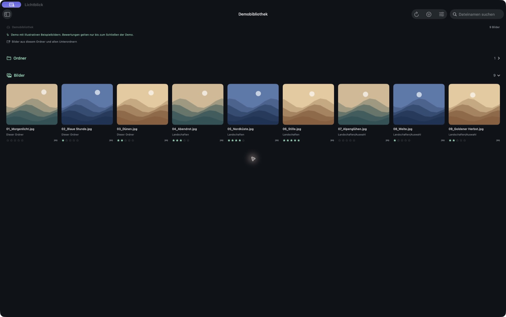
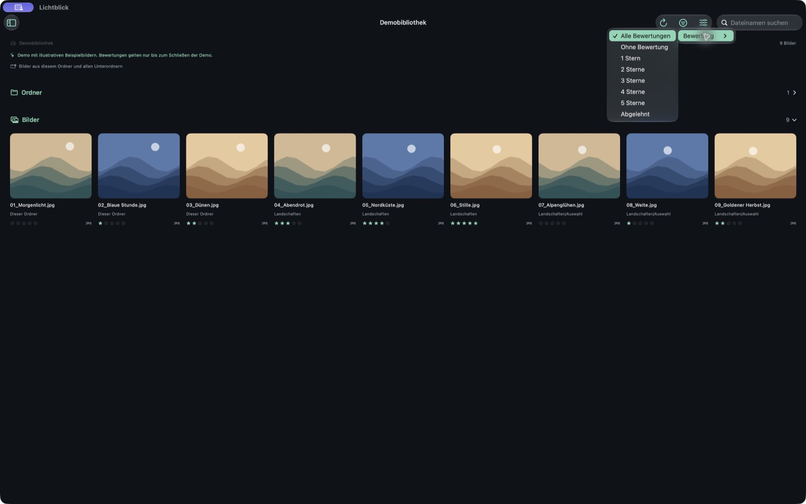
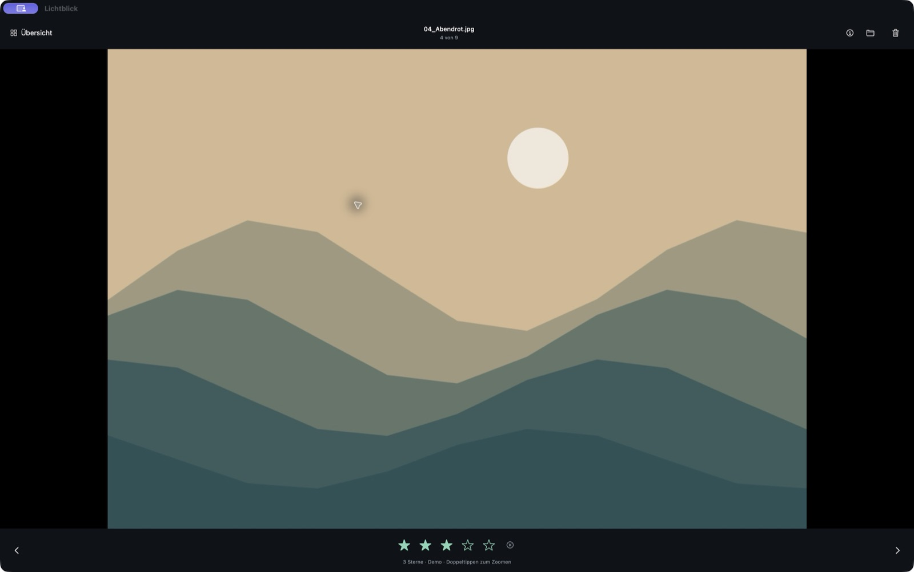

# Lichtblick · SMB Photo Rating

**English** | [Deutsch](README.de.md)

I developed Lichtblick for my own use. If you would like to use the app but cannot build it yourself, feel free to get in touch through a [GitHub issue](https://github.com/DWegmann/Lichtblick/issues). If there is enough interest, I could also submit the app to the App Store.

> **100% vibe coded:** All original app code was generated with AI. The ideas, requirements and direction of development come from Dominic Wegmann. The libraries used are independent projects by their respective authors.
>
> **Noncommercial reuse only:** The original project code may be used, modified and shared under the [PolyForm Noncommercial License 1.0.0](LICENSE.md). This license does not permit commercial use.

A native SwiftUI app for iPadOS 17 and later. Browse photos directly on an SMB 2/3 share and assign 0–5 stars. The repository contains an app project you can open directly in Xcode and a metadata module that can be tested separately.

## Example screenshots

These screenshots show the German Mac Catalyst version with its built-in demo library and generated landscape illustrations. The app is primarily designed for iPad, where the arrangement of controls may differ. Both English and German are supported.

### Library

Photo grid with star ratings and photos from subfolders.



### Rating filter

Filter the library to show unrated photos, photos with exactly 1–5 stars, or rejected photos.



### Photo viewer

Large photo view with navigation and direct star rating controls.



## Origins and license

Lichtblick is a fully AI-generated, “vibe coded” app implemented natively in **Swift and SwiftUI**. The statement about AI generation applies to the original project code, not to the third-party libraries it uses.

The original project code is published under the **PolyForm Noncommercial License 1.0.0**. Noncommercial use, modifications, derivative projects and redistribution are permitted under its terms. Sales, paid services and other commercial uses are not permitted by this license. Redistribution must retain the license text or its URL and the required notices. The full [license text](LICENSE.md), including its provisions for noncommercial organizations, is authoritative.

Required Notice: Copyright 2026 Dominic Wegmann

This license applies to the original project components to the extent that the relevant rights exist. Third-party libraries, their source code and their license texts retain their own licenses; this project's noncommercial restriction does not limit their independent rights. Notices and license texts for AMSMB2 and libsmb2 are in [OpenSourceLicenses.txt](SMBRating/Resources/OpenSourceLicenses.txt).

The source code is publicly available for noncommercial reuse (“source available”); its commercial restriction means this release is not open source as defined by the OSI.

## Getting started

1. Open `SMBRating.xcodeproj` in Xcode. The scheme is **SMBRating** and the app is **Lichtblick**.
2. Xcode automatically downloads the pinned SMB library, AMSMB2 **4.0.3**.
3. Select an iPad simulator or a connected iPad. For a physical device, select your own development team and, if necessary, your own bundle identifier under **Signing & Capabilities**.
4. Run the app and choose **Open demo library** or **Connect to SMB server**. The demo contains generated landscape illustrations; changes exist only in memory.

Mac Catalyst is also enabled for local testing. The primary target remains iPadOS. In Xcode, select **My Mac (Mac Catalyst)** and run with **⌘R**.

## Language

The app supports **English and German** and follows the preferred device or app language. English is the fallback for other languages. On iPad, you can choose a language under **Settings → Apps → Lichtblick → Language** when iPadOS offers multiple preferred languages. Menus, status messages, dialogs, errors, VoiceOver labels and the local network permission explanation are translated. Your own filenames and folder names, as well as the demo filenames, remain unchanged.

## Connection

- Server: `nas.local`, `192.168.1.10` or `smb://nas.local`; an optional port is supported.
- Share: for example, `Photos`, entered separately from the server.
- Starting folder: optional, for example, `Holiday/2026`, relative to the share.
- Username, password and optional domain; leaving the username blank uses `guest`.
- Optionally require SMB 3 encryption. Encryption is not guaranteed without this option. SMB 1 is not used.

The server and iPad must be able to reach each other, for example over the same LAN or a VPN. Allow the iPadOS local network permission prompt. The password can optionally be saved in the device-bound Keychain; other connection settings are stored in the app's local preferences. The host, share and other connection fields are saved locally as you type and restored when you reopen the dialog, even if the connection did not succeed. This draft is separate from the active connection and does not contain a password.

Successful SMB connections appear under **Saved connections** in the sidebar. Each connection's last opened folder is saved whenever you navigate to another folder. At the next launch, the most recent connection and its folder are restored. If its saved password is accessible in Keychain, the app connects automatically; otherwise, it shows the prefilled connection dialog for password entry. Passwords are stored separately for each connection. If the last folder no longer exists or cannot be accessed, the app opens the share root and displays a notice.

Selecting a sidebar entry restores that connection and its last folder. **Disconnect** disables automatic restoration at the next launch; saved connections remain available. The demo also remembers its last folder, but its ratings last only until the app closes. The previously stored single SMB connection is migrated automatically on the first launch of this version; its folder is now tracked as you navigate.

The SMB connection remains usable if Keychain is unavailable. A notice explains that the entered password is only used for the current session. Failure to delete a previously saved password is also reported explicitly. A locally signed Mac Catalyst build may encounter Keychain error `-34018`: select your own Apple Development team under **Signing & Capabilities** and rebuild to save passwords permanently. See [Apple's explanation of error -34018](https://developer.apple.com/forums/thread/114456).

## Photos and ratings

Active photo, rating and folder reads use the background time granted by iPadOS when you switch apps or lock the iPad. On iPadOS 26 and later, large rating scans started in the foreground (100 or more photos) also request a continued background processing task with a system progress indicator. If that request is denied, the shorter UIKit background time remains available. When the granted time runs out, pending reads wait until you return to the app and are retried there; completed filter matches and the ongoing folder search remain in memory. Cancellation, filter changes and connection changes end their associated pending operations. Ratings are kept only for the current view and read afresh for each new scan; only thumbnails are stored on disk. iPadOS determines background time and network availability. Force-quitting or system termination ends the work; it is not saved as a persistent job.

- Once a folder opens after connecting or restoring the last session, the sidebar is collapsed by default. Use the sidebar icon at the top left to show or hide it. If you manually show it, it stays open while navigating or reloading. The button remains accessible when the sidebar is collapsed; in narrow windows, the same button in the header closes the sidebar again.
- The library separates **Folders** and **Photos** into sections, each with a count. Both can be expanded or collapsed independently using their headings. The photo section remembers its state across launches; the folder section starts expanded when changing folders. Empty sections are hidden. Folder tiles open subfolders, while photos appear in an adjustable grid with locally generated thumbnails. Collapsing the photo section pauses preloading. The up arrow opens the parent folder; the clickable breadcrumb jumps directly to an ancestor or the share root. The share root remains accessible even when a starting folder was specified.
- While scrolling, up to twelve additional thumbnails before and after the visible photo tiles are preloaded. Visible photos take priority; distant preload requests are cancelled. Search and sorting also determine preload order.
- Only reduced thumbnails are stored in the local app cache and reused on subsequent visits. Ratings and other original metadata are read afresh from the server every time, including when a thumbnail is available in memory or on disk. The thumbnail appears while the app shows “Loading rating …”. If reading fails, an old rating is never shown as current. The previous cache containing stored metadata is removed on the first launch of this version. Cache entries are separated by server, share, username and file path; file size and modification time determine validity. Without a server modification time, only memory caching is used. The demo also uses memory only.
- Search by filename and use natural sorting in ascending or descending order.
- The filter icon at the top right offers **All ratings**, **Unrated**, exactly **1–5 stars**, and **Rejected**. The filter applies to the current view, including photos from subfolders when that option is enabled, and can be combined with filename search. Folders remain visible for navigation. Ratings are read afresh whenever you change the filter or search, or reload; results apply only to the current view and are not stored permanently. Matching photos appear progressively during the scan. A small status line shows progress; the library stays usable and provides **Cancel**. Unreadable ratings are reported and never treated as zero stars. **Check again** or **Read ratings again** repeats the scan. **Remove filter** restores the full current view. The photo viewer navigates through the filtered set; changing a rating updates whether that photo belongs in the library view.
- Under **View options** (the sliders icon at the top right), choose **Filename ascending/descending**. Sorting applies to both photos and folders, with folders shown first.
- The same menu switches between **Fill thumbnails** (the original tile-filling crop) and **Fit thumbnails**. Fit preserves the full aspect ratio and fills unused areas with the tile background. Thumbnail size, display mode and sort order persist across launches.
- The photo viewer supports swiping, previous/next buttons, pinch zoom and double-tap zoom. Swipe down to return to the library; while zoomed in, the same gesture pans the image. Returning is blocked while saving, moving or deleting. When navigating, the current image visibly slides out and the next or previous image slides in from the corresponding direction. An independent snapshot keeps the outgoing image visible until the transition ends, even if the next original is still loading. Neighboring thumbnails are prepared in advance, while the original file and rating are always loaded afresh; rating controls stay disabled until loading completes. With **Reduce Motion** enabled, the app uses a short crossfade instead. When zoomed in, swiping continues to pan the current photo.
- With an external keyboard: arrow keys navigate, `1` to `5` assign stars, `0` removes the rating, and Escape closes the viewer.
- Stars are written directly as **`xmp:Rating`** in the embedded XMP packet. `0` means unrated. An existing `-1` is shown as rejected; the app itself assigns `0…5`.
- Reading: XMP takes precedence, with IPTC-StarRating as a fallback. Image I/O also exposes XMP ratings through the IPTC-StarRating property. There is therefore no separate, potentially conflicting IPTC writing mode and no sidecar files.
- JPEG, PNG, HEIC/HEIF and single-page TIFF files are changed only through Image I/O's lossless image-source copy function. If the particular format is unsupported, an error is shown; there is no fallback to recompressing the image.
- Other common image and RAW extensions are available for viewing when the installed iPadOS version can decode them. RAW files, animations and multipage images remain read-only.

Grid ratings are read afresh from the original files independently of the thumbnail cache. Under **View options → Include subfolders**, you can extend the library to all photos in the current folder and its subfolders. This option applies only to the current view and collapses the folder section when enabled. Changing folders, reconnecting or relaunching disables it and expands the folder section again. **Reload folder** in the same folder preserves the option. Each photo then shows its relative folder; files with identical names remain separate. Folder tiles still open direct subfolders. The photo search can be cancelled. Hidden folders and symbolic directory links are not traversed. If a folder cannot be read, the app reports its path and keeps the previous view. **Reload folder** clears that folder's thumbnail cache and reads external changes again.

The demo library includes nested **Landschaften → Auswahl** folders so that you can try navigation without an SMB server.

## Moving files

In the library, long-press a thumbnail, or right-click on Mac, and choose **Move file**. In the viewer, the folder icon at the top right opens the same destination picker. Navigate using subfolders, **Parent folder** and the share root, then choose **Move here**. The picker starts in the photo's actual source folder, including when subfolders are included in the view. **Cancel** leaves the file unchanged.

Files can be moved within the same SMB share. The filename, image data and embedded ratings are preserved; the app moves the file directly on the server without downloading and uploading it again. The source folder cannot be chosen as the destination. Existing files or folders with the same name are not overwritten; the server-side rename also protects against an item created after destination selection. The SMB user needs the appropriate permissions in both folders. Folders and symbolic links are not moved.

After successful verification, the library updates. When subfolders are included, the photo remains visible at its new path if the destination is still within the displayed subtree. In the viewer, navigation continues with the next or previous photo; after the last photo, the library opens. Other changes are blocked while moving. Picking a destination changes neither the library's current folder nor the **Include subfolders** option.

If the server response or subsequent verification fails, the app shows the source and destination paths and asks you to reload. It does not automatically repeat the move. In the demo, moves last only until the demo library is reopened.

## Deleting files

In the library, long-press a thumbnail, or right-click on Mac, and choose **Delete file**. In the viewer, use the trash icon at the top right. Every deletion requires confirmation showing the filename and, for SMB files, the server, share and path. **Cancel** or dismissing the dialog leaves the file unchanged.

Only after confirmation is the file deleted directly from the SMB share. The app does not use a trash folder or provide undo. The SMB user needs delete permission. Other changes are blocked during deletion. On success, the file and its rating disappear from the library. The viewer shows the next photo, or the previous one at the end; after the final photo, the library opens. This function does not delete folders.

On error, the file remains in the view and a notice asks you to reload to check the server's actual state. In the demo, deletion affects only the current demo session: reopening the demo library restores its sample photos.

## Writing to the share

Rating requires read, write, delete and rename permissions in the folder. The app:

1. Compares the current server file with the original loaded in the viewer.
2. Creates a local copy with updated XMP metadata.
3. Writes a unique `.smbrating-….tmp` file in the same folder and verifies it by reading it back completely.
4. Checks the original again, renames it to `.smbrating-….backup` and verifies that backup too.
5. Renames the verified temporary file to the original filename, reads it back for verification and then removes the backup.

When a failure is unambiguous, the app attempts to rename the original back into place. If the network state is uncertain, backup files remain for manual recovery and their exact paths are displayed. Failure to clean up a backup is also reported. The app deliberately does not clean up these files automatically at its next launch.

This workflow is not a server-side transaction. Do not edit the same file in other apps at the same time. An interruption precisely between renames may require recovery from the hidden backup file. File system attributes, ACLs and alternate SMB data streams are not copied when the replacement file is created; the original filename and image metadata are preserved.

## Limits and validation

For large libraries, search, natural sorting and the position index are rebuilt only when the file list, search or sort order changes. Scroll events update only the preloading controller, which coalesces events from a photo row for 80 ms and uses the position index to find the next preload window. Loading a tile without an existing rating override does not publish a global state change. The rating row keeps a fixed height during loading to avoid shifting image rows. Ratings are still read afresh and are not cached. A new search or sort order returns the library to the top.

The entire file is transferred when a thumbnail is first loaded. After that, the local thumbnail cache can be used if the file is unchanged. Metadata is read afresh independently, which currently still requires transferring the original file. At most three image loads run concurrently, including at most one speculative request per preload window; overlapping thumbnail requests share a single load. The memory cache is limited to about 80 MB and survives folder changes. The disk cache contains only thumbnail image data with a maximum edge length of 520 pixels, never ratings, original metadata or original files; it is limited to 256 MB across all connections and evicts the least recently used entries first. The operating system may delete this cache. Rating and deleting invalidate the affected cache entries; **Reload folder** forces fresh thumbnails for the listed photos. Files larger than 128 MB are rejected. The viewer uses a preview up to 3200 pixels on its longest edge; rating still reads the original file afresh from the server.

Tests cover stars and repeated changes, preservation of pixels and metadata, JPEG/PNG/TIFF/HEIC, conflicts, corrupted uploads, missing permissions, recovery, lost responses to SMB renames, nonblocking Keychain errors on save and delete, and persistence of multiple connections, their folders and migration of old connection settings. They also cover recursive folder listings, duplicate filenames, subtree boundaries, skipped hidden folders and links, read failures and cancellation:

```sh
swift test
```

Simulator build without signing:

```sh
xcodebuild -project SMBRating.xcodeproj -scheme SMBRating \
  -destination 'generic/platform=iOS Simulator' CODE_SIGNING_ALLOWED=NO build
```

If Command Line Tools are active instead of Xcode, prefix the command with `DEVELOPER_DIR=/Applications/Xcode.app/Contents/Developer`.

Eight additional tests check delivery of early matches before remaining reads finish, exact rating filters including missing and rejected ratings, interaction with search and sorting, preservation of folder navigation and photo indices, fresh repeated reads, read errors, at most three concurrent reads, progress and cancellation.

Seven tests check background coordination with simulated system grants: continuing reads during a grant, pausing at expiration, resuming without rereading completed filter matches, cancellation while paused and during active transfers, denied grants, normal read errors, and late or stale grant events. Actual background duration on a device depends on iPadOS.

Four additional tests cover natural sorting and search, duplicate filenames in different folders, the position index and preload windows for a library with 1,200 entries in both sort directions. The UI was checked in a separate test copy with 1,203 demo photos by scrolling to the end and back, searching and opening a photo. An isolated comparison with 1,200 entries and 200 scroll events reduced time spent repeatedly sorting and finding windows from about 201 ms to 0.6 ms for indexed window lookup; this is not a frame-rate measurement. An additional model test confirms that 2,400 no-op rating cleanups do not trigger global view updates.

Seven additional tests cover the persistent thumbnail cache, including image-only storage, removal of the old metadata cache, connection isolation, file versions, invalidation, corrupted entries, size limits and preload windows.

Eleven tests cover moving files, including preservation of the file, freshly saved ratings with a changed file size, the share root as a destination, invalid paths, missing sources, name conflicts, missing permissions, cancellation and lost server responses. Library state transitions were also checked with a mock store: direct and recursive views, moves within and outside the displayed subtree, cache and rating cleanup, and stale requests after connection changes. The running Mac Catalyst demo was used to check the context menu, destination picker, cancellation, moves from the library and viewer, preservation of a five-star rating saved immediately beforehand, and returning to the library after the final photo.

Four additional localization tests check completeness of both language tables, matching placeholders, formatted progress and deletion messages, and the local network permission explanation. The localized app was also checked in English and German in a separate Mac Catalyst test copy, including the English connection dialog and photo viewer.

Tests use Image I/O on macOS and a mock file store. iPad Simulator and Apple Silicon Mac Catalyst builds have been checked. In the running Mac Catalyst app, the grid, viewer, saving and rereading a demo rating were verified. Checks for the view settings included sorting, fitting the full image, top-aligned folders, remembered form input and relaunching in a nested demo folder. The deletion workflow was checked in the demo, including cancellation, confirmed grid removal, navigating to the next photo and returning to the library after deleting the last photo. Installation and successful process launch on a physical iPad were also verified. The recursive demo view was checked with nine photos at the root, six photos in a subfolder sharing the same viewer navigation, and disabling the option. A complete test against a real SMB server is still outstanding.

## Project structure

- `SMBRating/App`: app entry point and library state.
- `SMBRating/Views`: connection, grid, viewer and zoom.
- `SMBRating/Services`: SMB adapter, Keychain, image pipeline and demo.
- `SMBRating/Resources`: third-party notices and German/English localization tables.
- `Sources/RatingCore`: metadata and the verified write workflow.
- `Tests/RatingCoreTests`: tests without an SMB server, including localization checks.

APIs used: [AMSMB2](https://github.com/amosavian/AMSMB2/tree/4.0.3), [Apple Image I/O](https://developer.apple.com/documentation/imageio), [lossless copying of image sources](https://developer.apple.com/documentation/imageio/cgimagedestinationcopyimagesource(_:_:_:_:)). License texts for the SMB components are in `SMBRating/Resources/OpenSourceLicenses.txt` and accessible in the app under **About ratings**.
